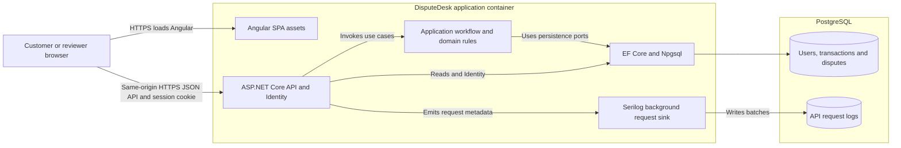
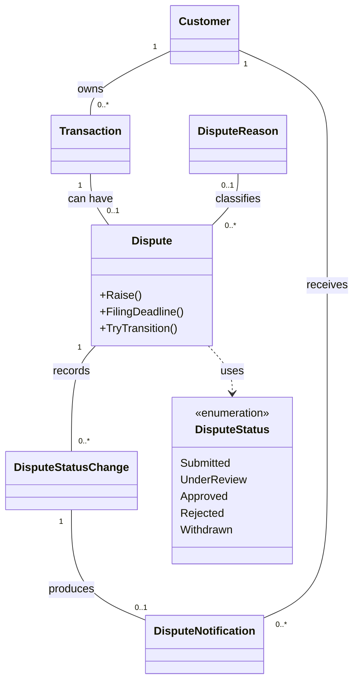
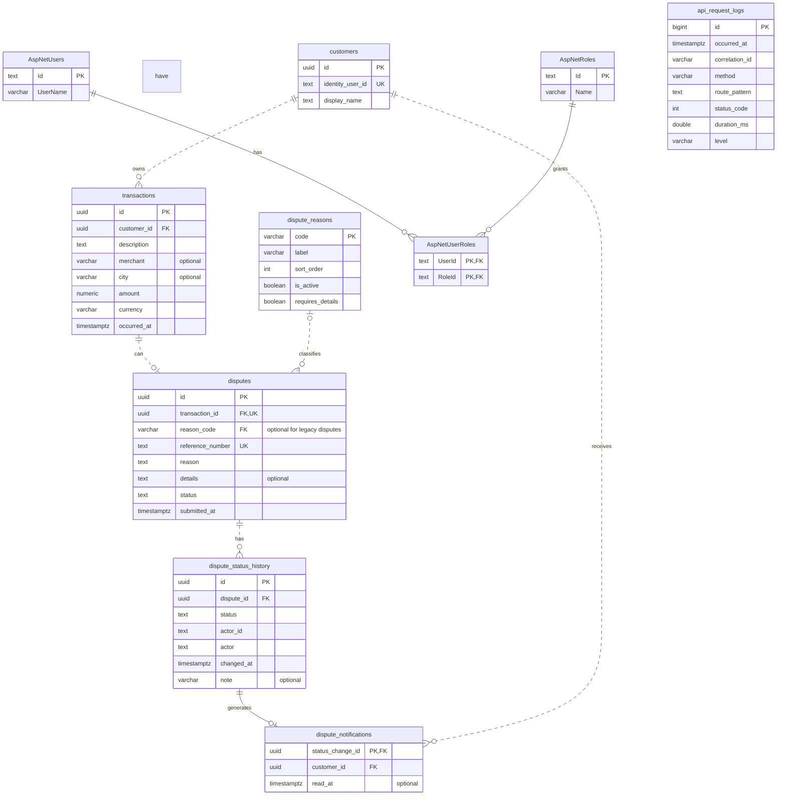

# DisputeDesk

DisputeDesk is a full-stack transaction dispute portal. Customers sign in, view their transactions, submit a dispute, and track the dispute in their history. The demo uses fictional customers and transactions.

## Run with Docker

You need Git, a browser, and Docker with the Compose plugin and Linux containers. The first build downloads the base images and dependencies. Compose starts its own PostgreSQL database and applies the EF Core migrations. The reviewer does not need a Neon account.

### Install Docker on Windows

If Docker is already running in Linux container mode, skip to [Start the demo](#start-the-demo).

1. Check that your Windows version and hardware meet the Docker Desktop requirements. Hardware virtualization must be enabled. [Docker Desktop for Windows](https://docs.docker.com/desktop/setup/install/windows-install/)
2. If WSL is missing, open PowerShell as Administrator and run `wsl --install --no-distribution`. Restart Windows if prompted. Then run `wsl --update` and `wsl --version` to check your installation. [Microsoft WSL commands](https://learn.microsoft.com/windows/wsl/reference)
3. Install Docker Desktop from the Windows download page, choose the WSL 2 backend, and start Docker Desktop. Keep it in Linux container mode. Docker Desktop includes Compose. [Docker Desktop WSL 2 setup](https://docs.docker.com/desktop/features/wsl/)
4. Open a new PowerShell window and verify that Docker can start a Linux container.

   ```powershell
   docker compose version
   docker run --rm hello-world
   ```

### Start the demo

1. Clone the public repository and open its folder. The default branch, `main`, contains the complete application.

   ```powershell
   git clone https://github.com/MasegoMpshe/DisputeDesk.git
   Set-Location DisputeDesk
   ```
2. Copy `.env.example` to `.env` using `Copy-Item .env.example .env` in PowerShell or `cp .env.example .env` in Bash. The example values are disposable credentials for this local demo. To customize them before first startup, use an alphanumeric PostgreSQL password and set each demo password to at least six characters with an uppercase letter, a lowercase letter, a number, and a symbol.
3. Build and start the stack.

   ```sh
   docker compose up --build -d
   ```

4. Open [https://localhost:8443](https://localhost:8443). Compose generates a self-signed development certificate, so your browser may ask you to trust it or continue to this local address. The API and Angular UI share this HTTPS origin.
5. Sign in as `demo-naledi` with `DEMO_NALEDI_PASSWORD` from your `.env` file, or as `demo-thabo` with `DEMO_THABO_PASSWORD`.

The optional `demo-reviewer` account is provisioned when `DEMO_REVIEWER_PASSWORD` is set in `.env`. If you are reusing an older `.env`, copy that entry from `.env.example`. Sign in as `demo-reviewer` with the password value without the surrounding quotes.

If reviewer sign-in fails after updating an existing Docker checkout, rerun the one-time setup from the repository root.

```powershell
docker compose run --build --rm setup
docker compose up --build -d
```

Setup synchronizes the existing demo reviewer's password with `.env` and clears any reviewer lockout. The existing PostgreSQL volume and saved disputes are preserved.

To build just the application image, run `docker build -f DisputeDesk.Api/Dockerfile -t disputedesk .` from the repository root. Use Compose for the accompanying database, HTTPS configuration, and demo initialization.

- `docker compose ps -a` shows the database, one-time setup, and app status. The setup container should exit with code 0.
- `docker compose logs setup app db` shows startup and migration output.
- `docker compose down` stops the stack and keeps the database.
- `docker compose down --volumes` deletes the local database and certificate. Use this to start with fresh demo data or to apply new demo account or database passwords. This deletes saved disputes in the local Compose instance.

## Run without Docker

Use the .NET 10 SDK, Node.js 24.15 or newer in the 24.x line with npm, Git, and a browser. Use a **fresh PostgreSQL database** from either a local instance or a hosted provider such as Neon. For Neon, copy the direct .NET/Npgsql connection string. Visual Studio is optional.

The commands below are for PowerShell 7.2 or later. Run them from the repository root.

1. Trust the API development certificate.

   ```powershell
   dotnet dev-certs https --trust
   ```

2. Set the connection string and choose passwords for the two fictional customers. The prompts mask the values as you enter them.

   ```powershell
   $apiProject = '.\DisputeDesk.Api'
   dotnet user-secrets set 'ConnectionStrings:DisputeDesk' (Read-Host 'PostgreSQL connection string' -MaskInput) --project $apiProject
   dotnet user-secrets set 'DemoAccounts:demo-naledi:Password' (Read-Host 'Choose a demo-naledi password' -MaskInput) --project $apiProject
   dotnet user-secrets set 'DemoAccounts:demo-thabo:Password' (Read-Host 'Choose a demo-thabo password' -MaskInput) --project $apiProject
   ```

   To enable the demo reviewer, also set its password before provisioning.

   ```powershell
   dotnet user-secrets set 'DemoAccounts:demo-reviewer:Password' (Read-Host 'Choose a demo-reviewer password' -MaskInput) --project $apiProject
   ```

3. Apply the migrations, seed the fictional customers and transactions, and provision the demo logins. Use the same password rules as in the Docker setup.

   ```powershell
   $env:ASPNETCORE_ENVIRONMENT = 'Development'
   dotnet run --project .\DisputeDesk.Api --no-launch-profile -- --Database:Migrate=true --Database:SeedDemoData=true --Database:ProvisionDemoAccounts=true
   ```

   For an existing development database, rerun this step after updating the reviewer password in .NET User Secrets. The API uses User Secrets when launched directly from Visual Studio.

4. Start the API in this terminal. Swagger UI is at [https://localhost:7051/swagger](https://localhost:7051/swagger) in Development.

   ```powershell
   dotnet run --project .\DisputeDesk.Api --launch-profile https
   ```

5. From the repository root in a second terminal, install Angular's dependencies and start the frontend. Open [https://localhost:4200](https://localhost:4200) and sign in with either demo account and the password you chose. The Angular dev server uses a self-signed certificate and may prompt for local browser approval.

   ```powershell
   Set-Location .\disputedesk-web
   npm.cmd ci
   npm.cmd start
   ```

## Build and test

From the repository root on a machine with .NET and Node.js:

```powershell
dotnet build .\DisputeDesk.slnx --configuration Release
dotnet test .\DisputeDesk.slnx --configuration Release --no-build
Set-Location .\disputedesk-web
npm.cmd ci
npm.cmd run build
npm.cmd test -- --watch=false
```

On macOS or Linux, use `npm` and slash-separated paths. GitHub Actions runs the .NET tests against a disposable PostgreSQL service and builds and tests Angular. A separate Docker job starts a fresh Compose stack and checks submission, reviewer approval, the customer timeline, notification read state after sign-in, and customer isolation.

The PostgreSQL integration tests require `DISPUTEDESK_TEST_POSTGRES` to contain a connection string for a test PostgreSQL server and a role that can create databases. The tests create and remove a uniquely named database. With the variable set, run `dotnet test .\DisputeDesk.slnx --configuration Release` from the root. Without it, the PostgreSQL tests are reported as skipped.

### Review the workflow

1. Sign in as `demo-naledi`. On a fresh database, the dashboard shows three transactions, including an expired Bookshop purchase, and zero disputes.
2. Open a transaction, choose **Dispute this transaction**, pick a reason, and submit. The first timeline entry should be **Submitted**. Return to **View all disputes** and sign out.
3. Sign in as `demo-reviewer`. Open the case from the review queue, choose **Start review**, and record an approval or rejection with a decision note. Return to the queue and check that the closed dispute is gone.
4. Sign out and sign back in as `demo-naledi`. The bell shows two unread updates, one for **Under review** and one for the decision. Open either update to mark it as read and see the dispute timeline. Refresh and check that the remaining unread count is one.
5. Open **View all disputes** and filter by the decision status and submission date. The matching row shows the transaction amount. Clear the filters to return to the whole list.
6. Submit a different transaction as a second dispute and withdraw it while it is **Submitted**. Confirm that the timeline records **Withdrawn**. Sign in as `demo-thabo` and verify that Naledi's disputes and notifications are absent.

### Browse transactions

The header shows the signed-in customer name, or the reviewer’s username. The transaction list supports search by description, merchant, or city, inclusive UTC dates, and an open or closed dispute window. Sort by date or amount and use **Previous** and **Next** to move through the results, ten at a time.

When demo generation is enabled, each batch includes three recent purchases and two purchases beyond the 120-day dispute window.

### Verify an expired transaction

1. Sign in as `demo-naledi`, open **View all transactions**, search for **Bookshop**, and choose **Apply**. The purchase is marked **Dispute window closed**.
2. Open it to see the filing deadline in UTC and the link to dispute history. Open a recent transaction to compare the available filing action.
3. If you already have a demo database and run without Docker, add the sample by rerunning the seed step from the repository root.

   ```powershell
   $env:ASPNETCORE_ENVIRONMENT = 'Development'
   dotnet run --project .\DisputeDesk.Api --no-launch-profile -- --Database:Migrate=true --Database:SeedDemoData=true
   ```

   The demo seed keeps existing transactions and disputes. The .NET tests cover the exact deadline, rejection just after it, and reviewer actions on existing disputes after their transaction deadline.

### Verify lifecycle endpoints

In Development, use Swagger with a customer or reviewer session. Call `GET /api/auth/session` to verify the active role.

- Customers can call `POST /api/disputes/{id}/withdraw` with `{}` while their dispute is Submitted. New disputes can be filed up to and including 120 days after the recorded transaction time.
- Reviewers can open `GET /api/reviewer/disputes`, start review with `POST /api/reviewer/disputes/{id}/review` and `{}`, then submit a decision to `POST /api/reviewer/disputes/{id}/decision` with `{"status":"Approved","note":"Review outcome"}` or a Rejected status.
- Customers can check their timeline at `GET /api/disputes/{id}` and notifications at `GET /api/dispute-notifications`. Mark an update as read with `PUT /api/dispute-notifications/{id}/read`.

### Dispute references and history pages

New disputes receive a short reference such as `DD-00000001`. Existing references remain valid. The customer dispute history shows ten results per page and keeps the selected status and date filters while paging.

### Health and API errors

- `GET /health/live` returns HTTP 200 when the API can respond.
- `GET /health/ready` returns HTTP 200 when PostgreSQL is reachable and its migrations are current, or HTTP 503 when the API cannot serve database-backed requests. The Docker image uses this endpoint for its health check.
- API errors use Problem Details JSON for standard HTTP statuses. On an expired session, the portal takes the user back to sign in.

### Request logging

Serilog writes structured JSON to the console. API responses include an `X-Correlation-ID` header, and standard Problem Details responses include the same ID in `correlationId`. For local Docker logs, use `docker compose logs app`.

Development and Docker Compose also enable asynchronous PostgreSQL request logging. Run the database migration from the setup instructions before starting the app. Use `RequestLogging__PersistToPostgreSql=false` to keep console logging only. The `api_request_logs` table stores the route template, HTTP method, status, duration, and correlation ID. It stores no request body, query string, cookies, user identifiers, or exception details.

```sql
SELECT occurred_at, correlation_id, method, route_pattern, status_code, duration_ms
FROM api_request_logs
ORDER BY occurred_at DESC
LIMIT 20;
```

## Architecture

DisputeDesk is a **layered monolith with a feature-based Angular frontend**. The Docker app serves the compiled Angular SPA and ASP.NET Core API from the same HTTPS origin. PostgreSQL runs separately. One application deployment simplifies local review and keeps cookie authentication on a single origin. The UI and API ship together in the demo, while their source and tests stay independent.

The backend uses dependency inversion in its core, following a Clean Architecture approach. The project references go from Application to Domain and from Infrastructure to Application and Domain. The API references Application to call the use cases and Infrastructure to wire up EF Core, Identity, and their implementations. [Microsoft architecture reference](https://learn.microsoft.com/en-us/dotnet/standard/modern-web-apps-azure-architecture/common-web-application-architectures)

| Layer | Responsibility | Why it is useful |
| --- | --- | --- |
| [Domain](DisputeDesk.Domain/) | Owns the inclusive 120-day filing rule and allowed dispute transitions in `Dispute`. | The rules can be tested with plain .NET objects, without starting HTTP or PostgreSQL. |
| [Application](DisputeDesk.Application/) | Coordinates use cases in `DisputeWorkflow` and defines interfaces for reads and persistence. | The same filing and transition rules apply across controller actions. Use cases can be tested with substitute implementations. |
| [Infrastructure](DisputeDesk.Infrastructure/) | Runs PostgreSQL queries, maps the schema with EF Core, and handles database concurrency and migrations. | SQL and persistence behavior can change without changing the domain rules. |
| [API](DisputeDesk.Api/) | Defines HTTP endpoints, validates request data, authorizes customers and reviewers, and maps results to HTTP responses. `Program.cs` wires the dependencies together. | Clients get a consistent HTTP contract and ownership checks stay on the server. |
| [Angular](disputedesk-web/src/app/) | Groups routes, components, and API services around transactions, disputes, reviewer work, and other features. | Each feature can be maintained locally. Lazy routes load features on demand, and the customer and reviewer views share the same dispute record and timeline components. |

Angular route guards select the correct screens for each role. ASP.NET Core policies enforce access, and customer queries use the user ID from the authenticated session to scope transactions, disputes, and notifications. [Angular style guide](https://angular.dev/style-guide)

### System architecture



### Design decisions

| Decision | Rationale |
| --- | --- |
| Cookie session | Angular and the API share an HTTPS origin. ASP.NET Core Identity manages sign-in and sign-out, and the browser sends the secure, HTTP-only cookie with API calls. A JWT-based browser flow would add token storage and refresh handling without a cross-origin client requirement. |
| SameSite and JSON-only POSTs | `SameSite=Strict` limits when browsers send the session cookie across sites. Requiring JSON on POST write endpoints also blocks ordinary cross-site HTML form submissions. This depends on the same-origin deployment and its CORS policy. |
| One dispute per transaction | Customers can track one case and reference per purchase. A unique PostgreSQL index preserves this rule when requests arrive concurrently. |
| Store the reason code and filed label | The lookup code associates the case with the reason catalogue. The saved label lets a receipt show the wording the customer selected even after the catalogue changes. |
| PostgreSQL | Foreign keys, uniqueness, transactional writes, and concurrency controls keep disputes, history, and notifications consistent. The app can use PostgreSQL locally through Docker and in hosted development. |
| Database-generated references | A PostgreSQL sequence gives new disputes a short reference without collisions. The UUID still identifies the resource in API URLs, and authorization still checks ownership. Existing references are retained. |
| Structured request logs | Serilog emits JSON to the console and queues limited metadata for PostgreSQL. A log outage does not block HTTP processing, and a correlation ID connects a response to its log entries. |

### Design patterns in use

| Pattern | Where it appears | Why it fits |
| --- | --- | --- |
| Dependency injection and composition root | [Program.cs](DisputeDesk.Api/Program.cs) registers application interfaces, infrastructure implementations, and `TimeProvider`. | The API can swap dependencies for test doubles, and tests use a fixed clock to check the filing cutoff. |
| Application service and persistence port | [DisputeWorkflow](DisputeDesk.Application/Disputes/DisputeWorkflow.cs) coordinates submission and transitions through `IDisputeStore`. [DisputeStore](DisputeDesk.Infrastructure/Disputes/DisputeStore.cs) implements the port with EF Core. | The workflow expresses what must happen and keeps database exception handling and persistence details in Infrastructure. |
| CQRS-style read and write separation | `IDisputeReader`, `IReviewerDisputeReader`, and `IDisputeWriter` serve different consumers. Readers project view-specific data and writes go through the workflow. | Queries can be tailored to their screens while changes consistently enforce the domain rules. Both paths use the same PostgreSQL database. |
| Static factory and finite-state workflow | [Dispute.Raise](DisputeDesk.Domain/Dispute.cs) validates and creates a dispute. `TryTransition` evaluates the current status, actor, requested status, and decision note. | Records begin in a valid state and the allowed transitions live in one place. An explicit switch is easy to review for this small lifecycle. |
| Unit of work and optimistic concurrency | `DisputeStore.SaveTransitionAsync` saves the status, history entry, and notification together using one EF Core `SaveChangesAsync`. The dispute status is a concurrency token. | A failed transition leaves no partial history or notification. The database detects stale concurrent updates and its unique transaction index prevents duplicate disputes. |
| Functional HTTP interceptor | [session-interceptor.ts](disputedesk-web/src/app/auth/session-interceptor.ts) handles an expired signed-in session across API calls. | One Angular handler clears the session and redirects to sign-in if concurrent requests fail with HTTP 401. [Angular interceptor guide](https://angular.dev/guide/http/interceptors) |

### SOLID review

| Principle | Evidence in DisputeDesk |
| --- | --- |
| **S**ingle responsibility | `Dispute` owns business rules, `DisputeWorkflow` coordinates the use case, and `DisputeStore` commits it. Angular components render screens and their API services handle HTTP. |
| **O**pen/closed | Adding an ordinary dispute reason through reference data leaves the workflow code unchanged. Replacing a reader or store is possible behind its interface. Adding a new status is a deliberate change to the domain rules and the API and UI that expose it. |
| **L**iskov substitution | The API authorization tests replace reader and writer implementations through the same interfaces and check HTTP behavior. The PostgreSQL tests check that the production adapters satisfy ownership, persistence, and concurrency expectations. |
| **I**nterface segregation | Customer and reviewer readers have separate contracts. A dashboard reader only exposes dashboard data, and a dispute reader does not expose status mutation. |
| **D**ependency inversion | The domain references no other project. The application references Domain and depends on `IDisputeStore`, which Infrastructure implements. The composition root chooses the concrete implementation. |

Two API boundaries are more tightly coupled. [AuthController](DisputeDesk.Api/Controllers/AuthController.cs) queries `DisputeDeskDbContext` directly for the customer's display name. The [review actions](DisputeDesk.Api/Controllers/ReviewerDisputesController.cs) and [withdrawal action](DisputeDesk.Api/Controllers/DisputesController.cs) depend on the concrete `DisputeWorkflow`. A focused profile reader and a transition interface would make those actions easier to test in isolation.

The [domain tests](DisputeDesk.Tests/DisputeRulesTests.cs) cover the UTC cutoff and state transitions. The [PostgreSQL integration tests](DisputeDesk.Tests/DisputeLifecycleIntegrationTests.cs) cover ownership, concurrent writes, history, and notifications. Angular component tests and the [Docker smoke test](.github/scripts/docker-smoke.sh) handle the interaction and deployment cases. See [Build and test](#build-and-test) for verification commands.

### Exception handling

Expected business outcomes use typed results. The persistence layer catches specific PostgreSQL uniqueness violations and EF Core concurrency conflicts to turn duplicate filings and stale transitions into a conflict response. Unexpected API exceptions reach the global handler, which logs the failure and returns a generic Problem Details response with a correlation ID. The PostgreSQL log sink handles database and timeout errors at its own boundary, writes a short diagnostic to stderr, and lets Serilog retry the batch.

### UML domain model

The diagram shows the dispute model in code. A dispute starts as **Submitted**. A customer can withdraw it in that state. A reviewer can move it to **Under review**, then approve or reject it with a note.



### PostgreSQL entity relationship diagram

The ERD shows the application tables and the Identity tables used for sign-in and reviewer roles. Dashed connectors show relationships where the parent key is outside the child's primary key. The solid history-to-notification connector reflects the shared key. [GitHub diagram rendering](https://docs.github.com/en/get-started/writing-on-github/working-with-advanced-formatting/creating-diagrams)



- `customers.identity_user_id` links to `AspNetUsers.Id` in application queries and has a unique index. PostgreSQL has no foreign key for this link or for the history `actor_id`.
- `disputes.transaction_id` is unique. The history has a unique index on `(dispute_id, status)`. The workflow records the initial submission in history and creates notifications for subsequent transitions.
- `reason_code` is optional to support legacy records. `reason` stores the label recorded at filing time, and `read_at` is null while a notification is unread.
- The diagram omits Identity's supporting claims, external logins, and tokens tables, and EF migration bookkeeping. See the [EF Core mapping](DisputeDesk.Infrastructure/Persistence/DisputeDeskDbContext.cs) and [migration snapshot](DisputeDesk.Infrastructure/Migrations/DisputeDeskDbContextModelSnapshot.cs) for the full schema.

### Known limitations

- The Docker configuration is for local review. A deployed environment needs managed TLS and secrets, demo features disabled, and deployment-level security headers and login throttling.
- PostgreSQL request logs are best effort and have no automatic retention. The dispute timeline is the durable record of workflow actions.
- Customer transactions and disputes use offset pagination. The reviewer queue currently lists all open cases. Approval records a decision and does not send a payment or refund.

### What I’d do next

1. Add login throttling and deployment-level HSTS and CSP, and test the browser security policy.
2. Set retention and access controls for request logs, and send production telemetry to a central collector with alerts.
3. Page the reviewer queue and evaluate keyset pagination for customers with high transaction volumes.
4. Add a transactional outbox when a downstream system needs reliable dispute events.
